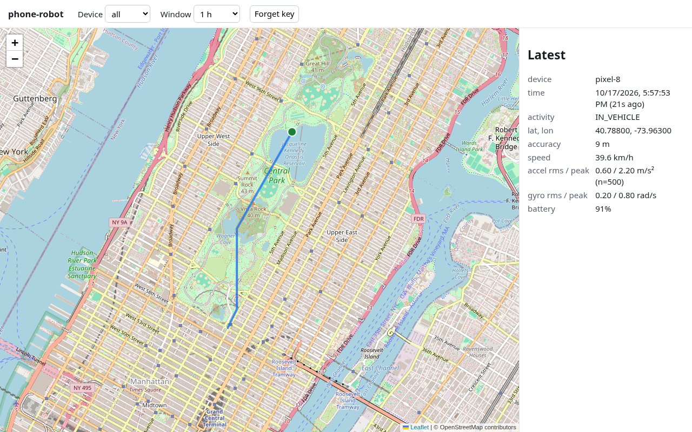
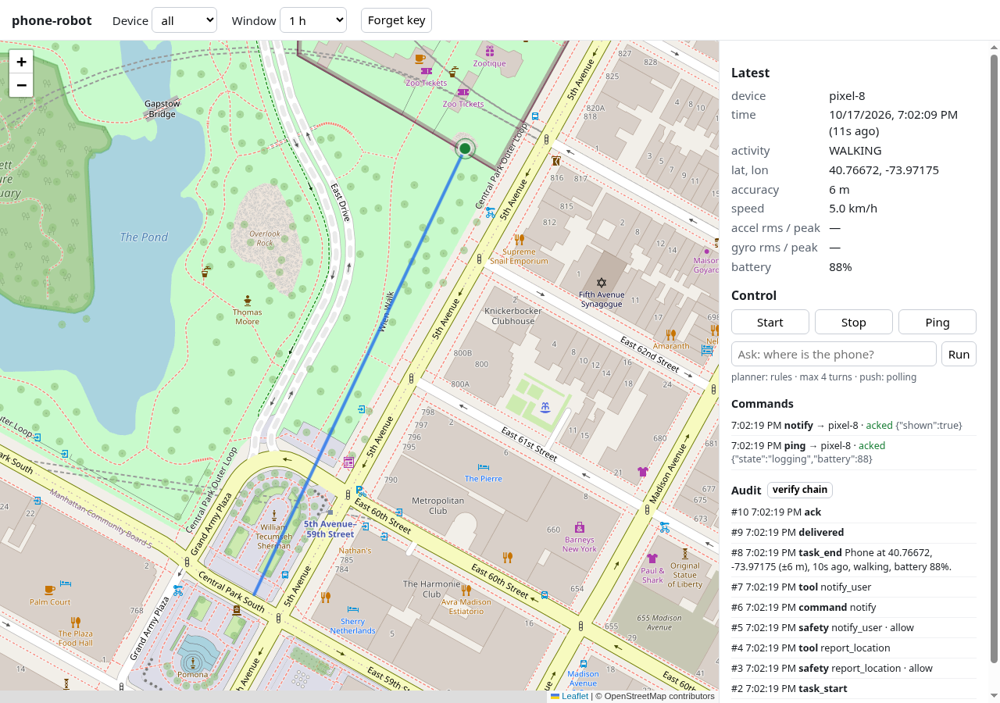

# phone-robot

[](https://github.com/fitzyracing1/phone-robot/actions/workflows/ci.yml)

**Milestones 1 and 2 of the phone-robot plan.** An Android phone logs its GPS position, activity (still, walking, driving)
and a motion summary every 10 seconds and streams them to your own small server, which stores everything and shows
the latest point and recent track on a map. **Milestone 2** adds remote start/stop/ping, a small task planner
with three tools, a code-level safety layer, an append-only audit log and a DIS dependency gate (see below).
There are still no calls and no SMS.


*The server page with demo data: a walk, then a short drive.*

```
android/   Kotlin app (minSdk 26, targetSdk 35): settings screen + foreground service → batches → POST /ingest
server/    zero-dependency Node server: POST /ingest → NDJSON, GET /healthz, map page, DIS example config
```

## 1. Run the server

You need Node 18+ (or Docker). It has no dependencies.

```bash
cd server
export INGEST_TOKEN=$(openssl rand -hex 24)   # the phone's upload token (min 16 chars)
export VIEW_TOKEN=$(openssl rand -hex 24)     # optional; key for the map page (defaults to INGEST_TOKEN)
npm start                                      # → http://localhost:8080
npm test
```

| Env | Default | |
|---|---|---|
| `INGEST_TOKEN` | required | bearer token the app sends to `POST /ingest`; the server refuses to start without one |
| `VIEW_TOKEN` | `INGEST_TOKEN` | bearer token for `/api/*`, which the map page uses |
| `PORT` | `8080` | |
| `DATA_DIR` | `./data` (`/data` in Docker) | one `points-YYYY-MM-DD.ndjson` per UTC day |
| `RECENT_MAX` | `5000` | points kept in memory for the page; reloaded from disk on restart |

| Route | Auth | |
|---|---|---|
| `POST /ingest` | `Authorization: Bearer $INGEST_TOKEN` | body `{device, samples:[{t, loc?, activity?, transitions?, motion?, battery?, charging?}]}`, max 500 samples / 1 MB. The server validates it and drops unknown fields. |
| `GET /healthz` | none | `{ok, points, uptimeS}`. Contains no location data. |
| `GET /` | none (shell only) | the map page. Open `https://<server>/#key=<VIEW_TOKEN>`: the key stays in the URL fragment, so it never reaches server logs, and is saved in the browser. |
| `GET /api/latest`, `GET /api/track?minutes=60&device=` | `Authorization: Bearer $VIEW_TOKEN` | JSON for the page |
| `GET /commands?device=`, `POST /commands/ack`, `POST /devices/fcm` | `INGEST_TOKEN` (device) | milestone 2: the phone fetches and acknowledges commands, and registers its FCM token |
| `POST /commands`, `POST /tasks`, `GET /audit`, `GET /api/commands`, `GET /api/features` | `VIEW_TOKEN` (owner) | milestone 2: see below |

The page loads Leaflet 1.9.4 from unpkg (pinned with SRI) and map tiles from OpenStreetMap. It sends a strict CSP and has no tracking.

**Docker:** `docker build -t phone-robot-server server && docker run -p 8080:8080 -e INGEST_TOKEN=... -v $PWD/data:/data phone-robot-server`

**Railway** (not deployed yet):
1. Create a new project from this repo and set the service's root directory to `server`. `railway.json` builds the Dockerfile and health-checks `/healthz`.
2. Add a volume mounted at `/data`, and set `RAILWAY_RUN_UID=0` (Railway volumes are root-owned; the image otherwise runs as `node`).
3. Set `INGEST_TOKEN` (and `VIEW_TOKEN`) as variables.
4. Generate a domain. The app needs that `https://` URL.

**Watch it with [DIS](https://github.com/fitzyracing1/DIS):**
```bash
PHONE_ROBOT_URL=https://your-server.up.railway.app npx -y github:fitzyracing1/DIS once --config server/examples/dis.config.json
```
For the phone's own dependencies (FCM, Google Play services and so on), combine it with DIS's `examples/phone-providers.config.json`.

## 2. Get the APK

- **From CI:**
  1. Open the latest green run of [phone-robot ci](https://github.com/fitzyracing1/phone-robot/actions/workflows/ci.yml) on `main`.
  2. Under **Artifacts**, download `phone-robot-debug-apk` (you must be signed in to GitHub).
  3. Unzip it to get `app-debug.apk`.
- **Build it yourself:** with JDK 17 and the Android SDK (platform 35) installed, run `cd android && ./gradlew assembleDebug`. The APK lands in `android/app/build/outputs/apk/debug/app-debug.apk`.

This is a debug build, signed with a debug key. If Android refuses to install a newer APK over an older one ("package conflicts"), uninstall the old one first.

## 3. Sideload it on the phone

1. Copy `app-debug.apk` to the phone: download it on the phone, use Drive, or run `adb install app-debug.apk`.
2. Open it. Android asks you to allow **Install unknown apps** for the app you opened it from (Files, Chrome…). Allow it, then tap **Install**.
   Play Protect may warn about an unknown developer. Choose **Install anyway** (it's your build).
3. Open **phone-robot** and enter:
   - **Server URL:** your `https://` server URL (plain `http://` is refused because the upload carries your location and a token);
   - **Upload token:** the server's `INGEST_TOKEN`;
   - **Device name:** e.g. `pixel-8`.

   Tap **Save settings**.
4. Tap **Start logging** and answer the permission prompts:
   - **Location → While using the app, Precise** (required).
   - **Notifications** (Android 13+). Recommended: this shows the "Logging…" notification with a Stop button.
   - **Physical activity** (Android 10+). Needed for walking/driving transitions.
5. Optional: **Allow location all the time**. Logging with the screen off works without it. It only matters if Android kills the app and restarts the service later.
6. Optional: **Battery settings**. Some phones (Samsung, Xiaomi, OnePlus…) kill background apps aggressively. If logging stops with the screen off, set phone-robot to "Unrestricted" or "Don't optimise".
7. Open `https://<server>/#key=<VIEW_TOKEN>` to watch the track. To stop, tap **Stop logging** in the app or **Stop** in the notification.

## How the app works

- **One foreground service** (type `location`) with a visible notification. It runs only while you've pressed Start.
- **Every 10 s it writes one sample:**
  - the latest **Fused Location** fix: `PRIORITY_HIGH_ACCURACY` while moving, `BALANCED_POWER_ACCURACY` while the activity is `STILL`;
  - the current **activity** plus any **Activity Recognition transitions** (ENTER/EXIT for still, walking, running, bicycle, vehicle) since the last sample;
  - an **accelerometer and gyroscope summary** for the window: sample count, mean |a|, RMS and peak deviation from 1 g, and rotation speed;
  - the battery level.
- **Offline queue:** samples are appended to `files/queue/pending.ndjson` and sealed into a batch every 6 samples (1 min).
  - Batches are uploaded oldest first and deleted only after a 2xx.
  - Uploads back off from 30 s to 15 min and retry right away when the network comes back.
  - Up to 3 days of batches are kept. A batch the server rejects as malformed (400) is set aside rather than retried forever.
- **No wake locks:**
  - The 10 s clock is a Handler that the location callback nudges, and that callback is what wakes the CPU with the screen off.
  - Motion sensors run at 50 Hz with a 10 s `maxReportLatency`, so the sensor hub batches events instead of waking the CPU 50 times a second.
  - The app doesn't request a battery-optimisation exemption.
- **Privacy:** HTTPS only. Settings and queue are app-private, with backup and device transfer disabled. Nothing is sent anywhere except your server.

## Milestone 1 is done when

- [ ] **A walk** (≥ 10 min) shows up on the server page as a continuous track with the screen **off** the whole time. Activity reads `WALKING`, with an `ENTER WALKING` transition.
- [ ] **A short drive** (≥ 10 min) does the same, with `IN_VEHICLE`. Its transitions (`EXIT WALKING`/`ENTER IN_VEHICLE`, then back) line up with when you got in and out.
- [ ] Samples arrive about every 10 s, with no gaps over 1 min, while the screen is off for **30+ minutes**.
- [ ] Battery drain caused by phone-robot is **under ~5% per hour**. Check Settings → Battery → app usage, or compare the `battery` field over an hour with the phone otherwise idle.
- [ ] **Offline:** turn on airplane mode for 5 min while walking, then turn it off. The gap fills in from the queue and no samples are lost.
- [ ] DIS shows `phone-robot-server` lit, and it turns dark after 2 failed checks if the server is stopped.

## Milestone 2: remote control, planner, safety, audit



Nothing below is required. A milestone-1 server keeps working with the new app (it ignores the missing `/commands`),
and the milestone-1 app keeps working with the new server (`POST /ingest` is unchanged).

### Remote start / stop / ping

- **Polling (no setup):** the app calls `GET /commands?device=…` with its device token about once a minute (piggy-backing on the upload cycle) and acknowledges each command with `POST /commands/ack`.
  Unacknowledged commands are redelivered, and the app remembers handled ids so a command never runs twice.
- **FCM (optional):** the server also sends a high-priority data push, which only tells the app to poll right now. The command itself still comes from `/commands`, so a lost push costs at most one poll interval.
- **The commands:**
  - `stop` **pauses** logging: no samples, motion sensors off, location at low power every 60 s just to stay reachable. The notification says "Logging paused".
  - `start` resumes logging.
  - `ping` returns state, battery, queue size, fix age and app version (shown on the map page).
  - Stopping from the app or the notification still stops everything.
- **Starting remotely after a full stop** needs FCM *and* "Allow location all the time". Android only lets a high-priority push start a location service in the background with that permission. Without it, use pause/resume.
- **Map page:** Start / Stop / Ping buttons, recent commands with their acks, and when the phone last polled. Or use curl:
  `curl -X POST $URL/commands -H "authorization: Bearer $VIEW_TOKEN" -H 'content-type: application/json' -d '{"type":"ping"}'`

### Tasks: planner with three tools

`POST /tasks {"goal": "where is the phone?", "device"?: "pixel-8"}` (view token) runs a task and returns the transcript of every turn: the proposed tool, the safety verdict and the result.
You can also type the goal into the **Ask** box on the map page.

| Tool | Does |
|---|---|
| `report_location` | reads the latest logged point (position, accuracy, age, activity, battery) |
| `notify_user` | queues a `notify` command, which the app shows as a local notification (channel "Messages from your server") |
| `stop` | queues a `stop` (pause logging) and ends the task |

- **Default planner: deterministic rules.**
  - "where is the phone?" → `report_location` → `notify_user` with the position → done.
  - "stop logging" → `notify_user` → `stop`.
  - "tell me &lt;text&gt;" → `notify_user`.
  - "status" / "battery" → `report_location`.
  - Anything else ends with "no rule matched".
- **Optional LLM planner:** any OpenAI-compatible `/chat/completions` endpoint. Set `PLANNER_BASE_URL` (e.g. `https://api.openai.com/v1` or a local server), `PLANNER_MODEL` and `PLANNER_API_KEY`.
  - It is offered only the three tools as JSON function tools, gets one tool call per turn, and sees the safety layer's verdicts.
  - If it's dark, rate-limited or erroring, the task continues with the rules, and the switch is audited.

### Safety layer (code, not the model)

- **Tool allowlist and strict argument schemas:** unknown tools and unknown or oversized arguments are rejected, and control characters are stripped.
- **`maxTurns = 4` per task**, enforced by the loop. The safety layer can lower it, never raise it.
- **Rate limits:** `TASKS_PER_HOUR` (30), `NOTIFY_PER_HOUR` (10), `COMMANDS_PER_HOUR` (60), `LLM_CALLS_PER_HOUR` (60).
- **One recipient:** the owner's phone, meaning a device that has uploaded or polled with the device token. There is no tool or code path that can reach a phone number, an email address or anyone else.
- **Audit log:** `DATA_DIR/audit.ndjson` records every task, safety verdict, tool run, command, delivery, ack, gate decision and fallback. It is append-only and hash-chained.
  Read it with `GET /audit?limit=200&taskId=&kind=&verify=1` (view token); `verify=1` re-checks the chain.

### DIS dependency gate

Before using FCM or the LLM endpoint, the server checks whether the provider is lit (results are cached for 2 minutes):

- **With `DIS_URL`:** it asks your DIS, `GET $DIS_URL/lights/firebase-fcm/LIGHT` (run DIS with its `examples/phone-providers.config.json`). Set `DIS_LLM_TARGET` to a DIS target for your LLM provider.
- **Without it:** it reads the provider's public status feed with DIS's status logic (`lib/status-feeds.mjs`, vendored).
  - **FCM** uses Firebase's status feed for Cloud Messaging.
  - **The LLM** uses `PLANNER_STATUS_URL` (e.g. `https://status.openai.com/api/v2/status.json`, with `PLANNER_STATUS_FORMAT` `statuspage`|`google`|`apple` and optional `PLANNER_STATUS_COMPONENT`).

**Dark** means: FCM falls back to polling, and the LLM falls back to rules. Both are recorded as `gate_dark` in the audit log.
If the status can't be read, the provider is used and a `gate_unknown` entry is written.

### Setup

1. **Server:** nothing new is required. Redeploy, and the new routes are there. Optional env:

   | Env | |
   |---|---|
   | `FCM_SERVICE_ACCOUNT_JSON` | service-account JSON (or base64 of it) for FCM HTTP v1 |
   | `PLANNER_BASE_URL`, `PLANNER_MODEL`, `PLANNER_API_KEY` | OpenAI-compatible LLM planner |
   | `PLANNER_STATUS_URL`, `PLANNER_STATUS_FORMAT`, `PLANNER_STATUS_COMPONENT` | status feed for the LLM provider (gate) |
   | `DIS_URL`, `DIS_FCM_TARGET` (`firebase-fcm`), `DIS_LLM_TARGET` | use a running DIS as the gate |
   | `TASKS_PER_HOUR`, `NOTIFY_PER_HOUR`, `COMMANDS_PER_HOUR`, `LLM_CALLS_PER_HOUR` | safety rate limits |

2. **App:** install the new APK over the old one. If the debug key changed, uninstall the old app first; your settings will need re-entering.
   Allow **notifications** so `notify_user` messages can show.

3. **Firebase (optional, for instant delivery):**
   1. In the [Firebase console](https://console.firebase.google.com/), create a project (or reuse one) and add an **Android app** with package `com.fitzyracing1.phonerobot`.
   2. Download **google-services.json** into `android/app/`. It's git-ignored. Then rebuild the APK (`./gradlew assembleDebug`). Gradle applies the Google Services plugin only when that file exists.
      CI builds don't have it, so CI APKs use polling only.
   3. **Project settings → Service accounts → Generate new private key.** Put the JSON (or `base64 -w0` of it) in the server's `FCM_SERVICE_ACCOUNT_JSON` variable.
      Treat it as a secret: it can send pushes to your app.
   4. The app registers its FCM token with `POST /devices/fcm` when logging starts. The map page then shows "push: FCM + polling".

### Try it

```bash
URL=https://your-server.up.railway.app; V=$VIEW_TOKEN
curl -s -X POST $URL/tasks -H "authorization: Bearer $V" -H 'content-type: application/json' -d '{"goal":"where is the phone?"}'
# → the transcript; within about a minute the phone shows "Where is the phone? Phone at …"
curl -s -X POST $URL/commands -H "authorization: Bearer $V" -H 'content-type: application/json' -d '{"type":"stop"}'   # pause
curl -s -X POST $URL/commands -H "authorization: Bearer $V" -H 'content-type: application/json' -d '{"type":"start"}'  # resume
curl -s "$URL/audit?limit=20&verify=1" -H "authorization: Bearer $V"
```

**Milestone 2 is done when:**
- [ ] Ping returns the phone's battery within about a minute with the screen off (polling).
- [ ] Stop pauses logging (no new points), and start resumes it.
- [ ] "where is the phone?" ends with a notification on the phone.
- [ ] The audit chain verifies.
- [ ] With FCM set up, the same commands arrive within seconds.

Next steps are in the plan (milestone 3: Twilio SMS to an opt-in number with user confirmation, a camera snapshot tool, and an iOS port).

## License

[MIT](LICENSE)

## Plans

This project is free, and its license stays as is. Support it through [GitHub Sponsors](https://github.com/sponsors/fitzyracing1):

- **Free**: use the code, community support.
- **Pro ($49/month)**: priority issues and support.
- **Team ($199/month)**: priority support for your team plus early access.
